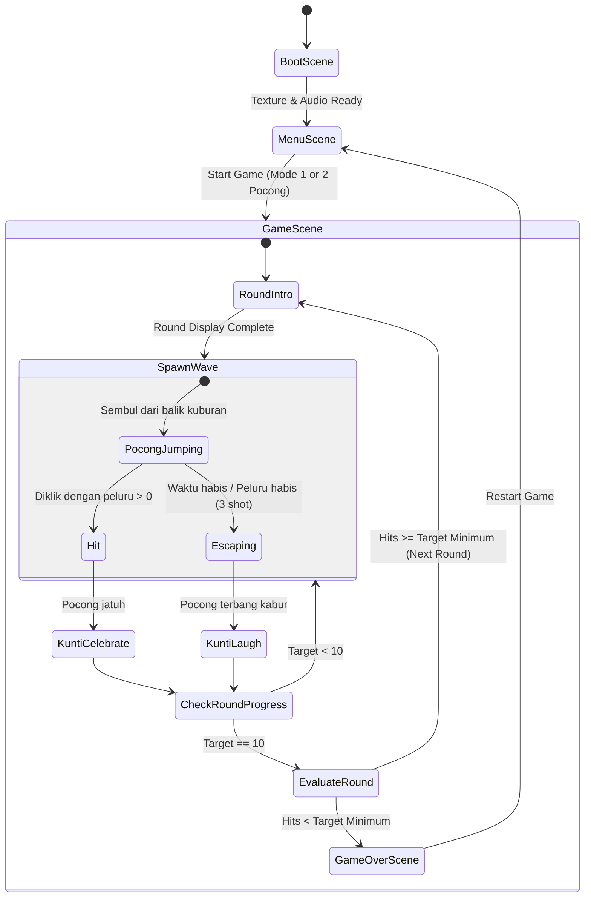

# Spec: Pocong Hunt (Cong Hunt)

## Objective
Membangun game web arcade retro 2D **"Pocong Hunt"** yang mengadaptasi mekanika klasik *Duck Hunt* NES ke dalam latar horor-komedi kuburan khas Indonesia. Game ini dirancang sebagai aplikasi web ringan, adiktif, dan instan dimainkan di desktop maupun mobile browser, dengan gameplay bidik-tembak berkecepatan tinggi, sistem ronde bertahap, dan karakter Kuntilanak yang mengejek pemain saat tembakan meleset.

## Tech Stack
- **Game Engine**: Phaser 3 (`phaser` ^3.80.0)
- **Bundler & Tooling**: Vite (`vite` ^5.0.0)
- **Language**: JavaScript (ES Modules, Modern Clean JS)
- **Audio Architecture**: Web Audio API Procedural Chiptune Synthesizer (Zero-latency 8-bit SFX, zero external assets)
- **Graphic Assets**: Procedural Pixel Art Generator ke Phaser Canvas Textures (100% self-contained, crisp pixel art, zero broken links)
- **Storage**: Browser `localStorage` untuk penyimpanan High Score permanen.

## Commands
- **Install**: `npm install`
- **Development**: `npm run dev` (menjalankan server lokal Vite dengan HMR)
- **Build**: `npm run build` (menghasilkan bundle statis produksi di direktori `dist/`)
- **Preview**: `npm run preview` (menjalankan server preview untuk bundle produksi)
- **Test/Lint**: `npm run test` (verifikasi integritas modul game & logika ronde)

## Project Structure
```text
20_CONGHUNT/
├── index.html                   # Entry point HTML game container & canvas viewport
├── package.json                 # Konfigurasi dependensi dan scripts Vite
├── vite.config.js               # Konfigurasi server Vite
├── docs/
│   └── intent/
│       └── pocong-hunt.md       # Confirmed Statement of Intent
├── src/
│   ├── main.js                  # Entry point inisialisasi Phaser.Game
│   ├── config.js                # Game configuration, constants, resolution & physics
│   ├── audio/
│   │   └── SoundManager.js      # Web Audio API 8-bit chiptune synthesizer
│   ├── gfx/
│   │   └── PixelArtGenerator.js # Procedural pixel art texture builder (Pocong, Kunti, Kuburan)
│   ├── entities/
│   │   ├── Pocong.js            # Class entitas Pocong (Putih & Merah, state, lompatan parabola)
│   │   ├── Kuntilanak.js        # Class Kuntilanak (animasi sembul nisan, tertawa, selebrasi)
│   │   └── Crosshair.js         # Custom retro crosshair cursor & light-gun flash
│   ├── ui/
│   │   └── HUD.js               # Tampilan peluru, indikator 10 target, ronde, skor, high score
│   └── scenes/
│       ├── BootScene.js         # Inisialisasi texture & sound generator
│       ├── MenuScene.js         # Menu utama, seleksi Mode A (1 Pocong) & Mode B (2 Pocong)
│       ├── GameScene.js         # Main game loop, spawner, collision/input, ronde logic
│       └── GameOverScene.js     # Layar Game Over, rekor skor, opsi coba lagi
└── SPEC.md                      # Dokumen spesifikasi teknis (ini)
```

## Game Architecture & State Machine



## Core Mechanics & Specifications

1. **Canvas Resolution & Scaling**:
   - Resolusi virtual: `320 x 240` (rasio klasik 4:3 bergaya retro arcade).
   - Mode scaling: `Phaser.Scale.FIT` dengan auto-center, pixel art rendering (`pixelArt: true`).

2. **Mekanik Menembak (Shooting & Bullets)**:
   - Jatah: 3 peluru per gelombang kemunculan.
   - Kontrol: Mouse click di PC dengan crosshair kustom; Tap touch di layar sentuh mobile.
   - Feedback: Efek layar sekejap memutih (*NES white flash frame*) + suara tembakan 8-bit.
   - Peluru berkurang setiap tembakan; jika peluru habis (0) dan pocong belum kena, pocong otomatis panik dan kabur (*Fly Away / Escape*).

3. **Perilaku Pocong (Targets)**:
   - **Pocong Putih**: Kecepatan normal (120-180 px/s), gerakan parabola memantul acak 3-4 kali sebelum kabur. Poin: 500 - 1000 pts.
   - **Pocong Merah**: Kecepatan tinggi (240-320 px/s), gerakan parabola zig-zag agresif. Poin bonus: 1500 - 2500 pts.
   - State Pocong: `SPAWNING` -> `HOPPING` -> `HIT` (berputar dan jatuh) -> `ESCAPING` (melayang lurus cepat ke atas).

4. **Kuntilanak (The Mocking/Celebration Entity)**:
   - Tersembunyi di balik layer gundukan tanah & batu nisan.
   - Jika pemain gagal menembak pocong: Sembul setengah badan, mata melotot jenaka, tertawa staccato 8-bit (*"hi-hi-hi-hi"*).
   - Jika pemain berhasil menembak pocong: Sembul sambil mengangkat pocong yang lunglai dengan ekspresi bangga.

5. **Sistem Progresi Ronde**:
   - Setiap ronde terdiri dari 10 target pocong (muncul bertahap 1 per 1 di Mode A, atau 2 sekaligus di Mode B).
   - Indikator 10 kotak target di bawah layar (berubah hijau jika kena, merah jika lolos).
   - Batas kelulusan ronde:
     - Ronde 1-3: Minimal 6 target kena.
     - Ronde 4-6: Minimal 7 target kena.
     - Ronde 7-9: Minimal 8 target kena.
     - Ronde 10+: Minimal 9 target kena.
   - Kecepatan pocong bertambah 10% setiap kenaikan ronde.

6. **Audio Synthesizer (Web Audio API)**:
   - `playGunshot()`: Pink noise burst berdurasi 120ms dengan rapid lowpass filter decay.
   - `playJump()`: Gelombang square/triangle frekuensi meluncur naik (150Hz -> 450Hz).
   - `playHit()`: Square wave crunch + noise decay (80ms).
   - `playFall()`: Pitched tone meluncur turun (400Hz -> 80Hz).
   - `playKuntiLaugh()`: 5-note staccato high-pitch arpeggio (750Hz, 900Hz, 750Hz, 900Hz, 1100Hz).
   - `playJingleRoundClear()` & `playJingleGameOver()`: Melodi chiptune retro 8-bit.

## Code Style & Example

Konvensi penulisan kode:
- Modular ES6 Classes untuk Scene dan Entities.
- Variabel konfigurasi dalam `config.js` huruf kapital (`CONFIG.RESOLUTION.WIDTH`).
- Method nama `camelCase`, class nama `PascalCase`.
- Jaga fungsi murni dan pemisahan rendering vs state.

Contoh style:
```javascript
// src/entities/Pocong.js
import Phaser from 'phaser';

export class Pocong extends Phaser.GameObjects.Sprite {
  constructor(scene, x, y, type = 'white') {
    const textureKey = type === 'red' ? 'pocong_red' : 'pocong_white';
    super(scene, x, y, textureKey);
    
    this.scene = scene;
    this.type = type;
    this.speed = type === 'red' ? 260 : 150;
    this.state = 'SPAWNING';
    this.jumpCount = 0;
    this.maxJumps = 4;
    
    scene.add.existing(this);
    scene.physics.add.existing(this);
  }

  onShot() {
    if (this.state === 'HIT' || this.state === 'ESCAPING') return;
    this.state = 'HIT';
    this.body.setVelocity(0, 0);
    this.scene.events.emit('pocong-hit', { pocong: this, score: this.getScoreValue() });
  }
}
```

## Testing Strategy
- **Unit Logic Testing**: Verifikasi `RoundManager` (perhitungan kuota kelulusan, skor, reset peluru) dan `SoundManager` (inisialisasi AudioContext).
- **Manual Verification Checklist**:
  1. Klik tombol start pada menu utama -> Masuk ke GameScene.
  2. Pocong muncul dan melompat di layar dengan variasi putih dan merah.
  3. Peluru berkurang dari 3 saat klik di mana saja; layar berkedip flash putih.
  4. Menembak pocong: pocong animasi jatuh, skor bertambah, Kuntilanak merayakan.
  5. Membiarkan pocong lolos / 3 peluru habis: pocong melesat kabur, Kuntilanak tertawa mengejek.
  6. Setelah 10 target: jika mencapai target lulus -> lanjut ke ronde berikutnya; jika gagal -> GameOverScene.
  7. High Score tersimpan di `localStorage` saat restart.

## Boundaries
- **Always do**:
  - Gunakan procedural pixel art dan Web Audio synthesizer agar game 100% mandiri tanpa file eksternal yang bisa hilang/404.
  - Pastikan crosshair mouse disembunyikan saat kursor berada di atas area canvas dan digantikan oleh sprite crosshair retro.
  - Pastikan game dapat dimainkan dengan nyaman baik di layar PC (mouse) maupun smartphone (touch screen).
- **Ask first**:
  - Menambahkan external assets berupa file MP3/PNG eksternal yang memerlukan hosting terpisah.
  - Mengubah aturan inti sistem kuota Duck Hunt klasik.
- **Never do**:
  - Menggunakan library pihak ketiga berat di luar Phaser 3.
  - Menghapus high score pemain tanpa konfirmasi.

## Success Criteria
- [ ] Game terpasang dengan rapi menggunakan Vite + Phaser 3, dapat dijalankan dengan `npm run dev`.
- [ ] Tampilan pixel art retro 8-bit kuburan malam hari (nisan, pohon, kabut, bulan) render tajam tanpa blur.
- [ ] Mekanisme tembakan 3 peluru dengan feedback visual dan audio berjalan akurat.
- [ ] Pocong Putih & Pocong Merah melompat dengan fisika dan lintasan yang halus dan menantang.
- [ ] Kuntilanak bereaksi tepat waktu (tertawa saat meleset, merayakan saat kena).
- [ ] HUD indikator 10 target, kuota kelulusan ronde, dan sistem High Score berfungsi dengan benar.
- [ ] Build produksi `npm run build` sukses menghasilkan bundel statis mandiri.

## Open Questions
- Tidak ada isu pemblokir (semua parameter inti telah disepakati pada tahap wawancara).
